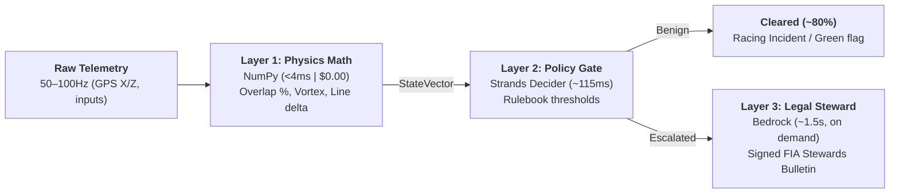

# ApexGuard

[](https://nextjs.org/)
[](https://fastapi.tiangolo.com/)
[](https://www.python.org/)
[](LICENSE)

An automated race-stewarding and telemetry forensics platform for circuit racing. ApexGuard evaluates dual-car telemetry at 50–100Hz, checks spatial and control data against official sporting rulebooks, and generates formal regulatory decisions in under two seconds.

---

## The Problem

High-frequency telemetry (50–100Hz) cannot be fed directly into large language models:
- **High Latency**: General LLMs take 2–5 seconds per inference, which is too slow for race control decisions under safety car or red flag windows.
- **High Cost**: Continuously passing raw coordinate streams costs upwards of $40/hour per session.
- **Mathematical Hallucinations**: General LLMs struggle with spatial coordinate geometry, frequently hallucinating overlap percentages, braking markers, and lateral trajectory lines.

ApexGuard solves this by separating physics calculations, policy evaluation, and legal documentation into three distinct layers.

---

## Architecture: Three-Tier Pipeline



### Layer Breakdown

1. **Layer 1: Deterministic Physics Math** (`backend/app/layer1_math/`)  
   Uses NumPy to project cars onto real-world horizontal ground coordinates $(X, Z)$ in meters. Calculates exact axle overlaps, apex distance, lateral closing rate, and whether the attacking car entered the blind-spot vortex before the turn-in point. Runs in under 4ms with zero LLM overhead.

2. **Layer 2: Fast Policy Gatekeeper** (`backend/app/layer2_gatekeeper/`)  
   Runs an ultra-low-latency decision model (Strands Decider 2B) against the mathematical state vector. Benign contacts, clean overtakes, and clear racing incidents are closed out in ~115ms, keeping race control focused on genuine infractions.

3. **Layer 3: Judicial Legal Steward** (`backend/app/layer3_steward/`)  
   When an incident warrants a penalty or official inquiry, Amazon Bedrock drafts a structured, legally sound FIA Stewards Bulletin. Decisions cite specific sporting regulations, timestamped keyframes, and penalty points.

---

## Features

- **2D Track Radar Replay**: Canvas-based real-world coordinate replay with dynamic car bounding boxes, 50% A-pillar overlap lines, and Randy Pobst Vortex of Danger entry wedges.
- **MoTeC-Style Telemetry Curves**: Synchronized speed, throttle, brake, steering angle, and gear telemetry traces mapped to millisecond keyframes.
- **G-G Friction Circle**: Bi-axial lateral and longitudinal acceleration radar showing grip limits at turn-in and apex.
- **Multi-Series Rulebooks**: Switch between rulebooks on the fly to see how different sporting codes judge the same incident:
  - **FIA Formula 1 (Strict)**: 50% front-axle overlap required at apex, zero contact tolerance.
  - **SRO GT3 (Lenient)**: 30% overlap required, body contact permitted under racing room guidelines.
  - **CIK-FIA Junior Karting (Safety)**: 60% overlap required, strict zero-contact enforcement.
- **Live Metric Tuner**: Adjust overlap percentages and line deviations in real time with immediate (~115ms) badge updates.
- **Pre-Flight Telemetry Ingestion**: Automated validator for sample rates (50–100Hz), missing frames, and channel integrity for raw FastF1 and TUMFTM telemetry files.
- **Offline Resilient**: Ships with deterministic rule-based mock fallbacks. Runs locally with full functionality even without AWS credentials or API keys.

---

## Quickstart

### Prerequisites
- Python 3.11+
- Node.js 18+ and npm

### 1. Clone the Repository
```bash
git clone https://github.com/andreigrigore464-lang/ApexGuard.git
cd ApexGuard
```

### 2. Backend Setup
```bash
cd backend
python -m venv venv

# Windows
.\venv\Scripts\activate
# macOS / Linux
source venv/bin/activate

pip install -r requirements.txt
uvicorn app.main:app --reload --port 8000
```
The FastAPI backend will start at `http://localhost:8000` (API documentation at `http://localhost:8000/docs`).

### 3. Frontend Setup
In a new terminal:
```bash
cd frontend
npm install
npm run dev
```
Open `http://localhost:3000` in your browser.

---

## Environment Variables (Optional)

ApexGuard runs completely offline out of the box using built-in rulebook logic and historical incident presets. To enable live AWS Bedrock and Strands Decider models, create a `.env` file in `backend/`:

```env
# Optional: Strands Decider API
STRANDS_API_KEY=your_strands_key

# Optional: Amazon Bedrock
AWS_ACCESS_KEY_ID=your_aws_key
AWS_SECRET_ACCESS_KEY=your_aws_secret
AWS_REGION=us-east-1
BEDROCK_MODEL_ID=anthropic.claude-3-5-sonnet-20241022-v2:0
```

---

## Incident Presets Included

The workbench includes pre-loaded historical and benchmark telemetry scenarios:
- **Monza 2021 (Verstappen vs. Hamilton)**: Curva Grande chicane overlap, sausage kerb launch, and apex room analysis.
- **Silverstone 2021 (Hamilton vs. Verstappen)**: High-speed Copse entry, missed apex line deviation, and vortex entry.
- **50/50 Racing Incident**: Mid-corner contact with shared responsibility.
- **Yellow Flag Unsafe Rejoin**: Re-entry into traffic with delta-V infractions.

---

## Repository Structure

```
ApexGuard/
├── backend/
│   ├── app/
│   │   ├── layer1_math/          # Overlap, line deviation & vortex math
│   │   ├── layer2_gatekeeper/    # Strands Decider client & triage policies
│   │   ├── layer3_steward/       # Amazon Bedrock FIA bulletin generator
│   │   ├── ingest/               # FastF1 / CSV parsing & track ribbons
│   │   ├── data/                 # Rulebooks & preset incident JSONs
│   │   └── main.py               # FastAPI routes & WebSocket entrypoint
│   └── requirements.txt
├── frontend/
│   ├── app/                      # Next.js App Router (Forensic Workbench)
│   ├── components/               # 2D Radar, MoTeC curves, G-G circle, modals
│   ├── lib/                      # API client and TypeScript definitions
│   └── package.json
└── README.md
```

---

## License

Distributed under the MIT License. See `LICENSE` for details.
